<p align="center">
  
  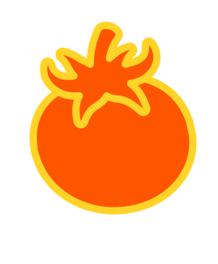
  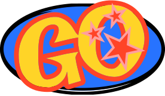
</p>

<h1 align="center">🥗 𝒮𝒜ℒ𝒜𝒟 * 𝒲𝒪ℛ𝒦𝒮ℋ𝒪𝒫 🥗</h1>

<p align="center">
  <b>Online workshop · 30/11 → 13/12</b><br>
  <i>What do a poster and an Olivier salad have in common? 🤔<br>
  In both, a bunch of pieces turns into one whole thing, if you slice and mix them right 🔪🥄</i>
</p>

<p align="center">
  <a href="https://qeugens.github.io/salad-poster/"></a>
  
  
</p>

<p align="center">
  <a href="https://qeugens.github.io/salad-poster/">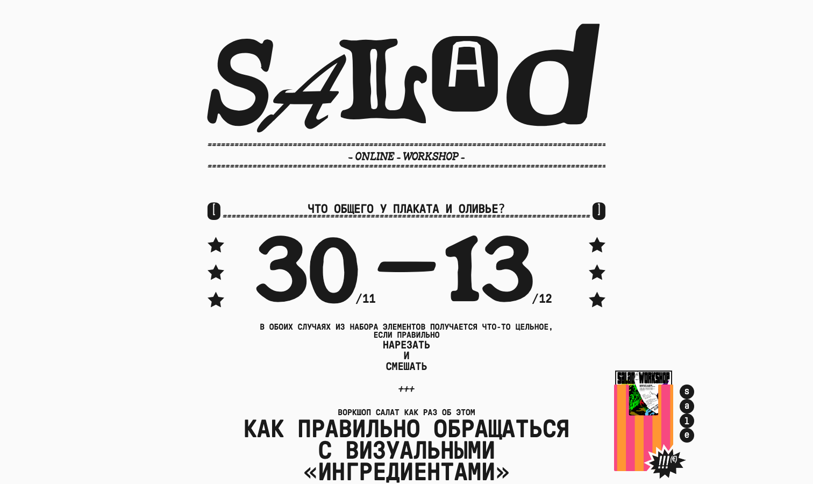</a>
</p>

---

## 💸 What's inside

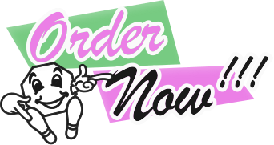

A one-page poster for the **SALAD** workshop, cut out of a Figma layout and tossed together by hand with plain HTML, CSS and JavaScript. No frameworks, no build step, just vibes 💅

- 🎉 **Sticker burst**: hover (or tap on a phone) the Order Now sticker and a pile of stickers goes flying
- 🖱️ **Custom cursors** and little hover doodles (flowers, stars, a pencil ✏️)
- 🔤 **Eleven weird fonts**, from gothic blackletter to brush script
- 📱 **Separate phone layout** with its own Figma frames
- 📐 Built on the Figma grid: 12 columns, 16px gutter, 9px module

<br clear="right">

## 🍒 The sticker gang

<p align="center">
  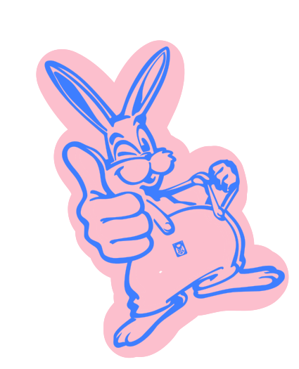
  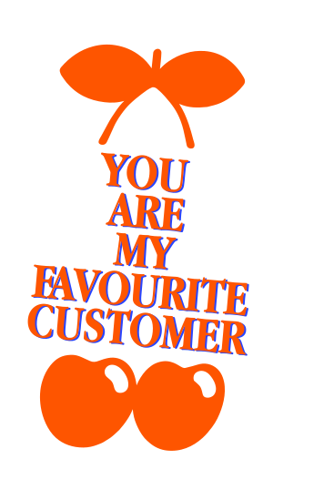
  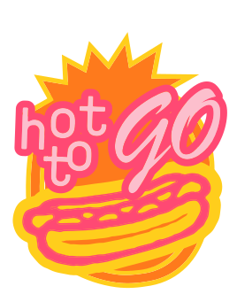
  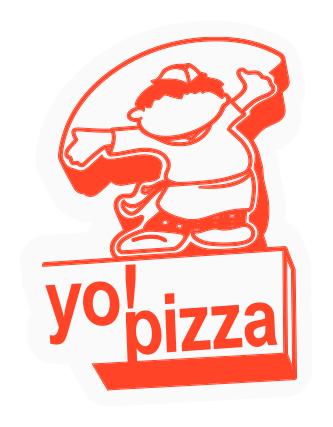
  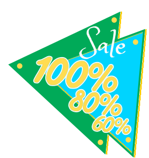
  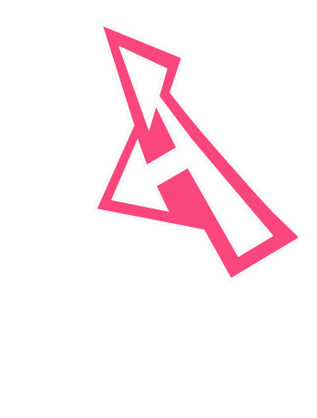
</p>
<p align="center">
  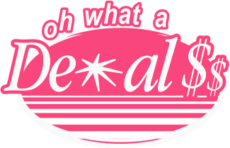
  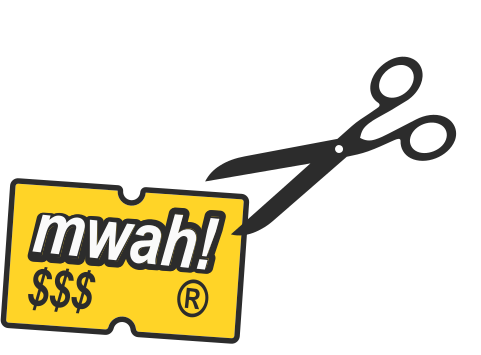
  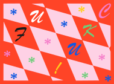
</p>
<p align="center">
  
  
  
  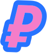
  
</p>

## 🗂️ Recipe (project structure)

| Ingredient | What it is |
| --- | --- |
| 🧾 `index.html` | the page |
| 🎨 `css/style.css` | styles |
| 🔤 `css/fonts.css` | the local fonts (Monofett comes from Google Fonts) |
| ⚡ `js/script.js` | interactions |
| 🖼️ `assets/images` | art exported from Figma |
| 🍕 `assets/images/burst` | the stickers thrown by the sticker burst |
| 🖱️ `assets/fonts`, `assets/cursors` | fonts and the custom cursors |

> [!TIP]
> 🧂 After changing a file, bump its `?v=` in `index.html` (or in `js/script.js` for the burst stickers) so browsers fetch the fresh copy instead of a stale one.

## 🔪 Cook it locally

Open `index.html` in a browser, or serve the folder:

```sh
npx serve .
```

## 🚀 Serve it

Hosted on **GitHub Pages** from the `main` branch root, and it rebuilds on every push 🔁
👉 **[qeugens.github.io/salad-poster](https://qeugens.github.io/salad-poster/)**

<p align="center">
  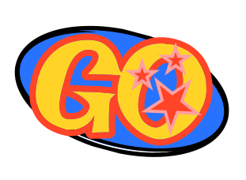
  
  
</p>

<p align="center"><i>sliced & mixed with 💖</i></p>
